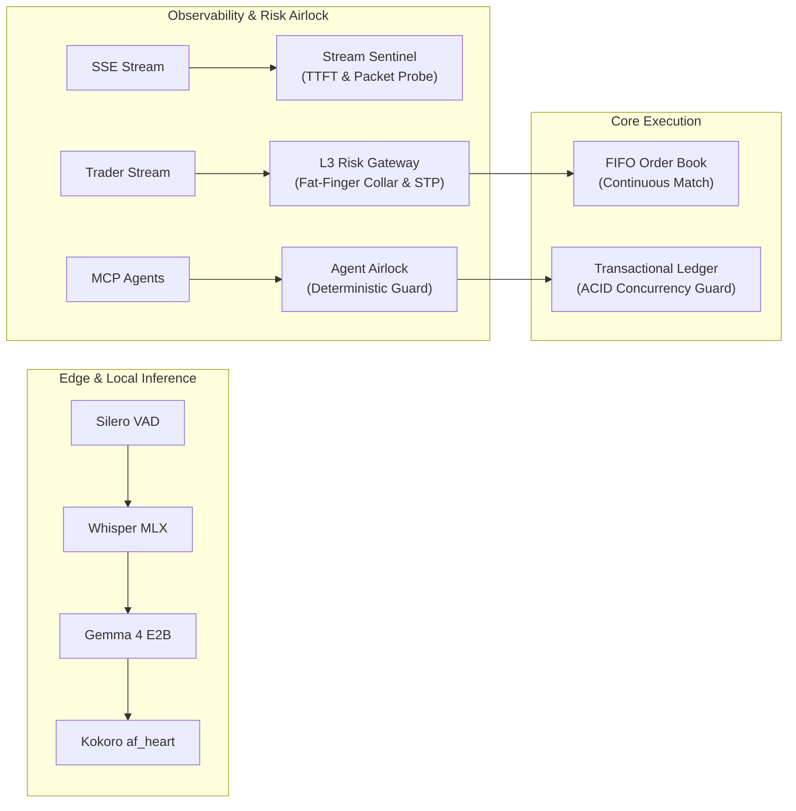

# elura172 · Systems, Observability & Distributed Infrastructure

> Systems and AI infrastructure engineer focused on **high-throughput execution engines**, **streaming observability & automated RCA**, **deterministic agent protocols**, and **fault-tolerant distributed ledgers**.

---

## 🏛️ Flagship Engineering Showcase

| System | Domain & Architectural Grounding | Core Capabilities & Integrity Guarantees | Repository |
|---|---|---|:---:|
| **OpenAI Stream Sentinel** | **Enterprise AI Streaming Observability & SRE** *(MIT 6.033 & 6.172 Grounded)* | Real-time SSE packet-level chunk telemetry, TTFT degradation anomaly traps, client backpressure simulation, deterministic auto-RCA probe. | [Inspect System →](https://github.com/elura172/openai-stream-sentinel) |
| **Order Matching Engine** | **Low-Latency Quantitative Market Infrastructure** *(L3 Continuous Double Auction)* | Price-time priority (FIFO), sub-millisecond execution, pre-trade risk filters (BBO ±5% fat-finger collars, self-trade prevention), rolling SHA-256 state ledger. | [Inspect System →](https://github.com/elura172/order-matching-engine) |
| **Hyperliquid Lab** | **Quantitative Time-Series Forecasting & DEX Execution** *(Google Research TimesFM 3.0)* | Foundation-model zero-shot volatility forecasting, fractional Kelly position sizing, paper-trading simulation on Hyperliquid L1 perp DEX. | [Inspect System →](https://github.com/elura172/hyperliquid-lab) |
| **Agentic Marketplace Gateway** | **Enterprise Agent Safety Airlock & Protocol Boundary** *(Model Context Protocol - MCP)* | Deterministic policy decision engine, token-bucket rate limiting, human-in-the-loop escalation airlock, idempotent JSON-RPC tool adapter. | [Inspect System →](https://github.com/elura172/agentic-marketplace-gateway) |
| **Telemetry Eval Engine** | **Autonomous Vehicle Ingestion & Dataset Certification** *(Statistical Drift & Outlier Detection)* | High-frequency sensor ingestion, differentiable streaming drift evaluation, automated data quality scoring for mission-critical ML pipelines. | [Inspect System →](https://github.com/elura172/telemetry-eval-engine) |
| **Concurrency Guard Engine** | **Financial Transaction Ledger & Race Condition Sentinel** *(ACID Isolation & AST Static Analysis)* | SQLite WAL double-entry ledger, balance overdraft prevention under extreme concurrency, AST static scanner for unisolated database transactions. | [Inspect System →](https://github.com/elura172/concurrency-guard-engine) |

---

## 🔬 Systems Architecture & Local AI Engines

### Specialized Tools & Research Infrastructure
- **[Veil Frequency Maps](https://github.com/elura172/veil-frequency-maps)** — Model Context Protocol (MCP) server over OSC with an Ableton Live / Max for Live control platform and real-time audio perception engine (`mirror_voice`).
- **[Projective Geometry Sequencer](https://github.com/elura172/projective-geometry-sequencer)** — Playable MIDI sequencer projecting spinning 3D Platonic solids through true perspective division onto microtonally quantized 2D orbits.
- **[Kokoro Gemma Voice](https://github.com/elura172/kokoro-gemma-voice)** — Low-latency, completely local voice loop on Apple Silicon (MLX Whisper Small + streaming Gemma + Kokoro TTS).
- **[Ops Core](https://github.com/elura172/ops-core)** — Dry-run-first operations platform for cataloging, pricing, inventory sync, and anti-overselling guarantees.
- **[Sovereign Cloud Platform](https://github.com/elura172/sovereign-cloud-platform)** — Zero-vendor-lock-in platform on CNCF standards with GitOps, Prometheus observability, and Cloudflare edge.
- **[AlphaFold Sound](https://github.com/elura172/alphafold-sound)** — Sonification engine mapping AlphaFold 3D protein coordinate matrices into harmonic multi-channel audio.
- **[Codex Claude Orchestrator](https://github.com/elura172/codex-claude-orchestrator)** — Dual-agent harness with independent planner and implementation review loops.

---

## 🛠️ Technical Competencies & Stack

- **Languages:** Python (asyncio, MLX, PyTorch, FastAPI, Pydantic), TypeScript / JavaScript (Node, Bun), C++ (systems basics), SQL (PostgreSQL, SQLite WAL).
- **Architecture & Paradigms:** Low-Latency L3 Order Books, Cryptographic State Ledgers, Model Context Protocol (MCP), SSE/Streaming Diagnostics, Idempotent Transactional Pipelines.
- **Infrastructure & Observability:** GitOps, CNCF standards, Prometheus / Grafana metrics, Cloudflare Workers / Edge, Docker, Systemd service isolation.

---

## 📬 Contact & Verification

- **GitHub:** [`github.com/elura172`](https://github.com/elura172)
- **Email:** `228485553+elura172@users.noreply.github.com`
